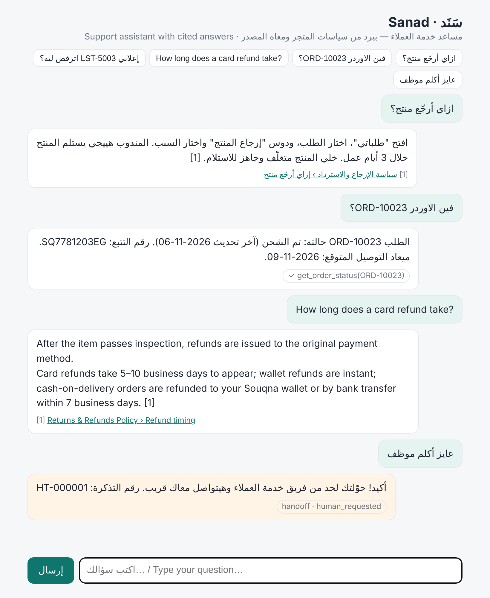
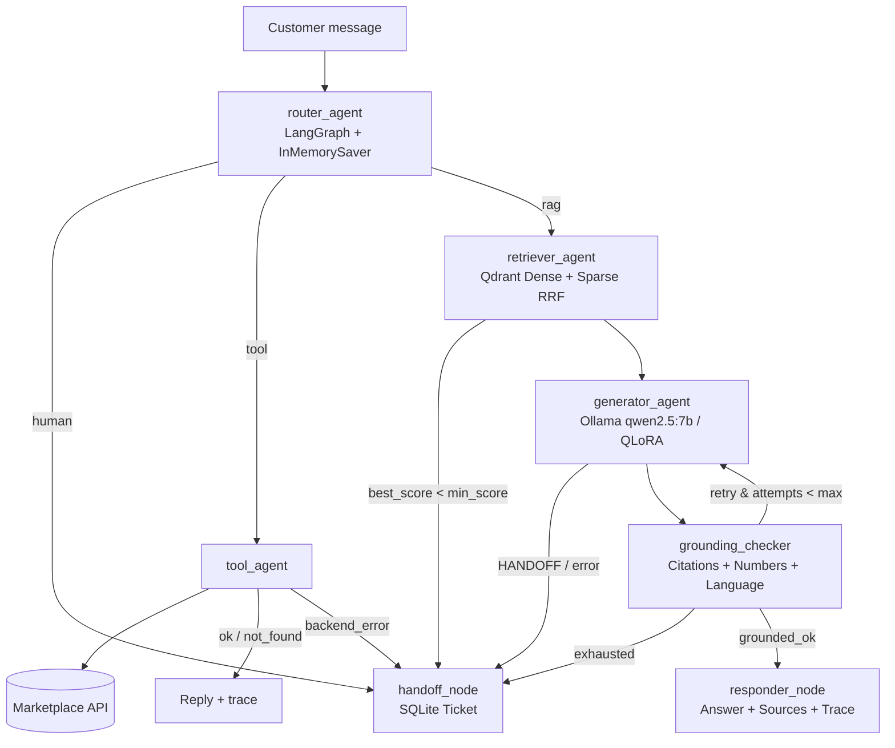

# Sanad (سَنَد) v2 — Multi-Agent Bilingual Support Assistant

A local, bilingual (Arabic / English) multi-agent customer-support assistant for an online marketplace.
Sanad v2 upgrades the original linear RAG pipeline into a stateful **LangGraph** multi-agent workflow backed by **Qdrant** hybrid vector search (`bge-m3` dense + Okapi BM25 sparse + RRF), a deterministic **grounding & hallucination checker** with self-correction retries, live backend API tools, human handoff ticketing (SQLite), and **RAGAS** evaluation (`Faithfulness` & `Answer Relevancy`). Everything runs locally with **Ollama** (plus optional QLoRA adaptation from [`qwen2.5-sanad-arabic-qlora`](https://github.com/3isa2002/qwen2.5-sanad-arabic-qlora)).



<sub>Screenshot taken in offline mode (hash embedder + extractive fallback LLM), so answers quote the policy text verbatim. With Ollama, `qwen2.5` writes the answer in its own words, still with citations.</sub>

## Features

- **Stateful Multi-Agent Orchestration (`LangGraph`)**: `router_agent` -> `tool_agent` / `retriever_agent` -> `generator_agent` -> `grounding_checker` (with self-correction retry loop) -> `responder_node` / `handoff_node`, plus `InMemorySaver` thread checkpointing (`conversation_id`) for multi-turn follow-ups and inspectable `trace` logs.
- **Dedicated Vector DB (`Qdrant`)**: Stores dense vectors (`bge-m3` / `hash`) and exact Okapi BM25 sparse vectors in one collection (`sanad_kb`) using Qdrant's native `Prefetch` + `FusionQuery(Fusion.RRF)`, supporting `:memory:`, local disk persistence (`data/index/qdrant`), and Qdrant server (`http://qdrant:6333` in Docker Compose). Legacy `numpy` backend stays supported via `SANAD_VECTOR_BACKEND=numpy`.
- **Bilingual, dialect-friendly**: detects Arabic vs English and replies in the same language. Normalizes Arabic text (alef/yaa/taa-marbuta forms, diacritics, tatweel, Arabic-Indic digits), so Egyptian-dialect questions like `ازاي أرجّع منتج؟` match the policy docs.
- **Grounding & Hallucination Checker**: verifies inline citations `[1]`, rejects phantom out-of-range `[n]` tags, checks numeric grounding against cited passages, validates language alignment, and retries generation before escalating to a human ticket (`grounding_failed` / `no_citation`).
- **Handoff instead of hallucination**: Sanad opens a ticket (SQLite) with the full `agent_trace` and context when retrieval confidence is low, grounding fails, the model replies `HANDOFF`, the LLM/backend fails, or the customer asks for a human.
- **Backend tools**: order and listing IDs are detected deterministically (`ORD-10023`, `الطلب رقم ١٠٠٢٥`, `LST-5003`), then fetched from the backend API with multi-turn reference carry-over.
- **HTTP API and web chat**: FastAPI `/chat` (with `trace` & `grounding_issues`), admin-protected `/handoffs` and `/admin/reindex`, `/health`, and an RTL-aware chat page at `/`.
- **Fully local and testable offline**: Ollama for chat and embeddings (or fine-tuned [`3isa2002/qwen2.5-7b-sanad-arabic-qlora`](https://huggingface.co/3isa2002/qwen2.5-7b-sanad-arabic-qlora) adapter). A hash embedder and extractive fallback LLM run all `91` tests without Ollama or Docker.
- **Golden + RAGAS Evaluation**: `sanad eval` runs the `37`-question golden suite and `sanad ragas` measures **RAGAS** `Faithfulness` and `Answer Relevancy`.

## How it works



The original v1 design notes are preserved in [PLAN.md](PLAN.md).

## Tech stack

| Layer | Choice |
|-------|--------|
| Language | Python 3.11+ |
| Agent Orchestration | **LangGraph** (`StateGraph`, conditional routing, `InMemorySaver` checkpointer) |
| Vector DB | **Qdrant** (`qdrant-client`, dense + Okapi BM25 sparse vectors, native `Fusion.RRF`) |
| LLM runtime | [Ollama](https://ollama.com) (`/api/chat`, `/api/embed`) |
| Chat model | `qwen2.5:7b` (or fine-tuned [`3isa2002/qwen2.5-7b-sanad-arabic-qlora`](https://huggingface.co/3isa2002/qwen2.5-7b-sanad-arabic-qlora)) |
| Embeddings | `bge-m3` (configurable; offline hash fallback) |
| API | FastAPI + Uvicorn, httpx |
| Storage | Qdrant collection + SQLite for handoff tickets |
| Evaluation | `sanad eval` (`37`-q golden set) + **RAGAS** (`Faithfulness`, `AnswerRelevancy`) |
| Tests | `pytest` (`91` tests, zero network/Ollama required) |
| Deploy | Dockerfile + Docker Compose (`ollama`, `qdrant`, `mock-backend`, `sanad`) |

## Getting started

### 1. Install

```bash
git clone https://github.com/3isa2002/sanad-support-rag.git
cd sanad-support-rag
python -m venv .venv && source .venv/bin/activate
pip install -e ".[dev]"
cp .env.example .env        # then edit the tokens
```

### 2. Pull the models (once)

```bash
ollama pull qwen2.5:7b
ollama pull bge-m3
```

### 3. Index the knowledge base

```bash
sanad ingest
# Indexed 44 chunks from 10 documents with ollama:bge-m3 → data/index
```

### 4. Run

```bash
python -m mock_backend      # terminal 1 — mock marketplace API on :8001
sanad serve                 # terminal 2 — Sanad on http://localhost:8000
```

Open http://localhost:8000 for the chat page, or http://localhost:8000/docs for the OpenAPI UI.

### No Ollama? Run fully offline

```bash
export SANAD_EMBEDDER=hash SANAD_LLM=fake
sanad ingest && sanad serve
```

### Docker Compose

```bash
docker compose up --build   # pulls the models on first run, then open http://localhost:8000
```

## Usage

### CLI

```bash
sanad ask "مصاريف الشحن كام؟"
# الشحن مجاني للطلبات فوق 500 جنيه ... و55 جنيه لباقي المحافظات. [1]
#   [1] الشحن والتوصيل › مصاريف الشحن  https://help.souqna.example/ar/shipping

sanad ask "فين الاوردر ORD-10023؟"
# الطلب ORD-10023 حالته: تم الشحن (آخر تحديث 2026-11-06). رقم التتبع: SQ7781203EG. ميعاد التوصيل المتوقع: 2026-11-09.

sanad ask "What is the capital of France?"
# I'm not sure about this one, so I've passed your question to our support team ... Ticket number: HT-000002
#   → handoff HT-000002 (low_confidence)

sanad search "الإعلان بيترفض ليه" -k 3     # inspect retrieval
sanad ask "..." --json                     # full structured response
```

### HTTP API

```bash
curl -s localhost:8000/chat -H 'content-type: application/json' \
  -d '{"message": "إعلاني LST-5003 اترفض ليه؟", "conversation_id": "c-42"}'
```

```json
{
  "answer": "الإعلان LST-5003 (Gaming laptop RTX 4060) حالته: مرفوض. سبب الرفض: فيه بيانات تواصل (رقم تليفون أو لينك) في العنوان أو الوصف. صلّح السبب وابعته تاني للمراجعة.",
  "language": "ar",
  "sources": [],
  "handoff": null,
  "tool_calls": [{"name": "get_listing_status", "arguments": {"id": "LST-5003"}, "ok": true, "result": {"...": "..."}}]
}
```

| Endpoint | Description |
|----------|-------------|
| `POST /chat` | `{message, conversation_id?}` → `{answer, language, sources[], handoff?, tool_calls[]}` |
| `GET /handoffs` | List handoff tickets (`?status=open&limit=50`). Requires the `X-Admin-Token` header. |
| `GET /handoffs/{id}` | One ticket, with the retrieval context that led to it. Admin only. |
| `POST /admin/reindex` | Re-read `data/kb/` and rebuild the index without a restart. Admin only. |
| `GET /health` | Model names, whether Ollama and the backend are reachable, and the index size. |

### Evaluation (`sanad eval` + `sanad ragas`)

```bash
sanad eval -v
sanad ragas --output data/eval/ragas_report.json
sanad graph   # print compiled LangGraph Mermaid topology
```

**Golden Benchmark (`n=37` questions, `Qdrant` + `LangGraph`):**

| Mode | Retrieval hit@4 | Answer Rate | Handoff Precision | Handoff Recall | Tool Accuracy |
| --- | ---: | ---: | ---: | ---: | ---: |
| **Offline (`hash:512` + `extractive`)** | `1.00` | `0.96` | `0.875` | `1.00` | `1.00` |
| **Live Ollama (`bge-m3` + `qwen2.5:7b`)** | `1.00` | `0.92` | `0.778` | `1.00` | `1.00` |

**RAGAS Benchmark (`n=25` answerable questions, `Qdrant` + `LangGraph` + live `Ollama qwen2.5:7b` & `bge-m3` — [`data/eval/ragas_report.md`](data/eval/ragas_report.md)):**

| RAGAS Metric | Score (0.0–1.0) |
| --- | ---: |
| Faithfulness (`answered=24/25`) | `0.7656` |
| Answer Relevancy (`answered=24/25`) | `0.6370` |

> Running live `RAGAS` against base `qwen2.5:7b` directly surfaced occasional language drift (`可以选择一种语言`) that motivated the QLoRA fine-tuning adapter in [`qwen2.5-sanad-arabic-qlora`](https://github.com/3isa2002/qwen2.5-sanad-arabic-qlora).

## Configuration

All settings come from environment variables or `.env`. See [.env.example](.env.example).

| Variable | Default | Purpose |
|----------|---------|---------|
| `OLLAMA_BASE_URL` | `http://localhost:11434` | Ollama server |
| `SANAD_CHAT_MODEL` / `SANAD_EMBED_MODEL` | `qwen2.5:7b` / `bge-m3` | Models |
| `SANAD_EMBEDDER` / `SANAD_LLM` | `ollama` / `ollama` | Set to `hash` / `fake` for offline mode |
| `SANAD_VECTOR_BACKEND` | `qdrant` | `qdrant` (default) or legacy `numpy` |
| `SANAD_QDRANT_URL` / `SANAD_QDRANT_PATH` | `""` / `data/index/qdrant` | Qdrant server URL (`http://qdrant:6333`) or local disk path |
| `SANAD_GROUNDING_RETRIES` / `SANAD_STRICT_GROUNDING` | `1` / `true` | Self-correction retries and numeric grounding guard |
| `SANAD_RAGAS_MODEL` | `qwen2.5:7b` | Ollama judge model for `sanad ragas` |
| `SANAD_TOP_K` | `4` | Passages given to the LLM |
| `SANAD_MIN_SCORE` | per embedder (0.45 / 0.15) | Retrieval confidence threshold for handoff |
| `SANAD_BACKEND_URL` / `SANAD_BACKEND_API_KEY` | `http://localhost:8001` / – | Marketplace API |
| `SANAD_ADMIN_TOKEN` | – | Protects `/handoffs` and `/admin/reindex` |

## Adding your own docs

Drop Markdown files into `data/kb/` with front matter:

```markdown
---
id: warranty-ar
title: سياسة الضمان
lang: ar
url: https://help.example.com/ar/warranty
---
## مدة الضمان
...
```

Each `##` section becomes one chunk and its heading is shown in citations. Run `sanad ingest`, or call `POST /admin/reindex`.

## Project structure

```
sanad-support-rag/
├── src/sanad/
│   ├── textnorm.py     # Arabic normalization, tokenizer, language detection
│   ├── kb.py           # Markdown loading + heading-aware chunking
│   ├── embeddings.py   # Ollama + hash embedders
│   ├── bm25.py         # Okapi BM25
│   ├── index.py        # Legacy NumPy hybrid index (SANAD_VECTOR_BACKEND=numpy)
│   ├── qdrant_store.py # Qdrant hybrid dense + sparse BM25 + RRF vector store
│   ├── models.py       # Shared response schemas, citation & intent helpers
│   ├── graph.py        # Stateful LangGraph multi-agent workflow & grounding checker
│   ├── llm.py          # Ollama chat client, extractive fallback, test double
│   ├── prompts.py      # Grounded, retry, and judge prompts
│   ├── assistant.py    # Assistant facade over LangGraph
│   ├── tools.py        # Order/listing ID extraction + status replies
│   ├── backend.py      # Backend API client
│   ├── handoff.py      # SQLite ticket store
│   ├── messages.py     # Bilingual canned messages
│   ├── api.py          # FastAPI app (/chat, /handoffs, /admin/reindex, /health)
│   ├── eval.py         # 37-question golden-set evaluation
│   ├── ragas_eval.py   # RAGAS Faithfulness & AnswerRelevancy evaluator
│   ├── cli.py          # `sanad` command (ingest/search/ask/serve/eval/ragas/graph)
│   └── static/index.html
├── mock_backend/       # Mock marketplace API (orders, listings)
├── data/
│   ├── kb/             # Sample policies (Arabic + English)
│   ├── mock_backend/   # Seed orders and listings
│   └── eval/           # questions.jsonl + ragas_report.{json,md}
├── tests/              # 91 pytest tests (incl. Qdrant, LangGraph & RAGAS)
├── Dockerfile, docker-compose.yml
└── PLAN.md
```

## Testing

```bash
pytest -q
```

All `91` tests cover Arabic normalization, chunking, BM25, Qdrant hybrid RRF retrieval & persistence, LangGraph routing/self-correction/multi-turn memory, RAGAS Faithfulness & AnswerRelevancy scoring, backend tools, FastAPI endpoints, and golden eval regression checks without requiring Ollama or network access.

## Limitations

- The `bge-m3` threshold (`0.45`) works cleanly (`retrieval_hit_at_k=1.0`, `handoff_recall=1.0`), though one Arabic listing query (`ينفع أبيع أدوية على الموقع؟`) fell slightly under `0.45`; tune `SANAD_MIN_SCORE` for your target KB.
- No customer authentication: anyone who knows an order ID can look up its status. Add auth before using this with real data.
- Multi-turn state uses `InMemorySaver` (in-process per `conversation_id`), so thread history resets across server restarts unless swapped to a SQLite/Postgres LangGraph checkpointer.
- The marketplace ("Souqna"), its policies and the order data are fictional sample content.

## Roadmap

- [x] **v1:** Hybrid NumPy+BM25 RAG, deterministic backend tools, SQLite handoffs, FastAPI + Docker Compose.
- [x] **v2 (Milestone 2):** Dedicated **Qdrant** hybrid vector store, stateful **LangGraph** multi-agent workflow with grounding/hallucination self-correction, and **RAGAS** benchmark.
- [ ] **v3 (Next — Milestone 3):** Serve the QLoRA fine-tuned Qwen model via **vLLM** (OpenAI-compatible GPU container), benchmark throughput/latency/VRAM, add **Kubernetes** manifests, and wire **Langfuse**/**LangSmith** tracing.
- [ ] Cross-encoder re-ranker (`bge-reranker-v2-m3`) & authenticated order lookups.

## License

[MIT](LICENSE)
