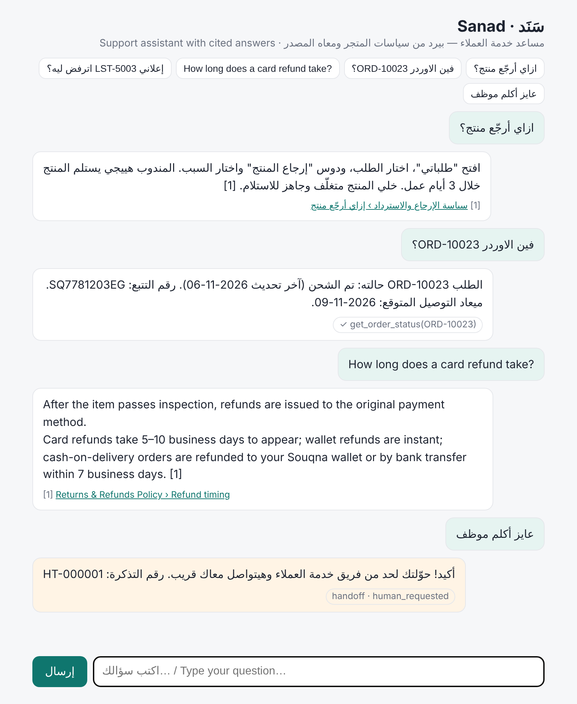
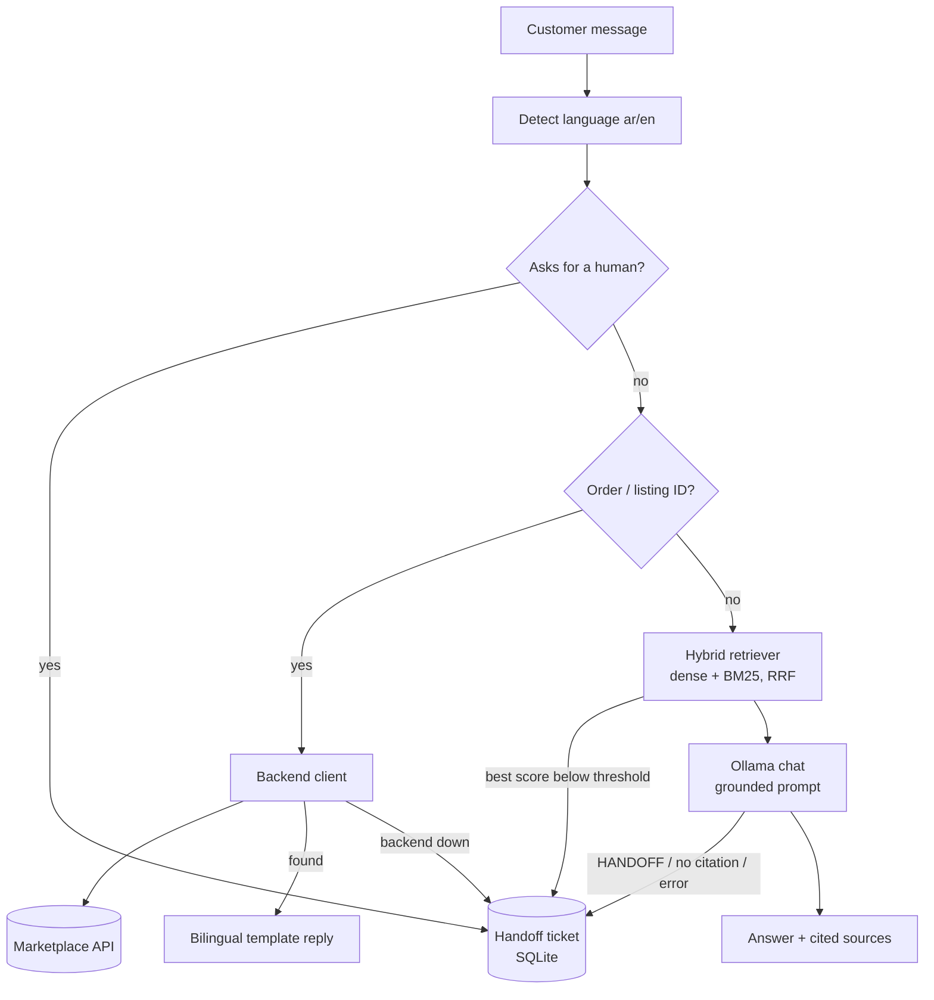

# Sanad (سَنَد) — Arabic Support Assistant

A local, bilingual (Arabic / English) customer-support assistant for an online marketplace.
Sanad answers customer questions from the help docs and policies with retrieval-augmented
generation (RAG) and **always cites its source**. When it isn't sure, it **hands off to a
human agent instead of making something up**. It also calls the marketplace **backend API**
to fetch live order and listing status. Everything runs on your machine with **Ollama**.



<sub>Screenshot taken in offline mode (hash embedder + extractive fallback LLM), so answers quote the policy text verbatim. With Ollama, `qwen2.5` writes the answer in its own words, still with citations.</sub>

## Features

- **Bilingual, dialect-friendly**: detects Arabic vs English and replies in the same language. It normalizes Arabic text (alef/yaa/taa-marbuta forms, diacritics, tatweel, Arabic-Indic digits), so Egyptian-dialect questions like `ازاي أرجّع منتج؟` match the policy docs.
- **Hybrid retrieval**: dense embeddings (`bge-m3` via Ollama) plus Arabic-aware BM25, fused with Reciprocal Rank Fusion. Same-language passages get a small boost.
- **Grounded answers with citations**: the model may only use the numbered passages and must cite them (`[1]`). The API returns structured sources (doc, section, URL, score).
- **Handoff instead of hallucination**: Sanad opens a ticket (SQLite) and tells the customer the ticket number when:
  - retrieval confidence is below a threshold, so the LLM is never called,
  - the model replies `HANDOFF`,
  - the answer has no valid citation,
  - the LLM or the backend fails, or
  - the customer asks for a human (`عايز أكلم موظف`, `talk to an agent`).
- **Backend tools**: order and listing IDs are detected deterministically (`ORD-10023`, `الطلب رقم ١٠٠٢٥`, `LST-5003`), then fetched from the backend API.
  - Replies come from bilingual templates, so statuses, dates and tracking numbers are never paraphrased by the model.
  - An unknown ID asks the customer to re-check it.
  - A status question without an ID gets a request for the ID.
- **HTTP API and web chat**: FastAPI `/chat`, admin-protected `/handoffs` and `/admin/reindex`, `/health`, and an RTL-aware chat page at `/`.
- **Fully local and testable offline**: Ollama for chat and embeddings. A hash embedder and an extractive fallback LLM let you run the whole pipeline, and all 80 tests, without Ollama.
- **Evaluation**: `sanad eval` runs a 37-question golden set and reports retrieval hit@k, answer rate, handoff precision/recall and tool-routing accuracy.

## How it works



The full design, assumptions and trade-offs are in [PLAN.md](PLAN.md).

## Tech stack

| Layer | Choice |
|-------|--------|
| Language | Python 3.11+ |
| LLM runtime | [Ollama](https://ollama.com) (`/api/chat`, `/api/embed`) |
| Chat model | `qwen2.5:7b` (configurable) |
| Embeddings | `bge-m3` (configurable; offline hash fallback) |
| Retrieval | NumPy dense index + custom BM25, Reciprocal Rank Fusion |
| API | FastAPI + Uvicorn, httpx |
| Storage | Index files on disk, SQLite for handoff tickets |
| Tests | pytest (80 tests, no network or Ollama needed) |
| Deploy | Dockerfile + Docker Compose (Ollama, model pull, mock backend, Sanad) |

## Getting started

### 1. Install

```bash
git clone https://github.com/3isa2002/sanad-support-rag.git
cd sanad-support-rag
python -m venv .venv && source .venv/bin/activate
pip install -e ".[dev]"
cp .env.example .env        # then edit the tokens
```

### 2. Pull the models (once)

```bash
ollama pull qwen2.5:7b
ollama pull bge-m3
```

### 3. Index the knowledge base

```bash
sanad ingest
# Indexed 44 chunks from 10 documents with ollama:bge-m3 → data/index
```

### 4. Run

```bash
python -m mock_backend      # terminal 1 — mock marketplace API on :8001
sanad serve                 # terminal 2 — Sanad on http://localhost:8000
```

Open http://localhost:8000 for the chat page, or http://localhost:8000/docs for the OpenAPI UI.

### No Ollama? Run fully offline

```bash
export SANAD_EMBEDDER=hash SANAD_LLM=fake
sanad ingest && sanad serve
```

### Docker Compose

```bash
docker compose up --build   # pulls the models on first run, then open http://localhost:8000
```

## Usage

### CLI

```bash
sanad ask "مصاريف الشحن كام؟"
# الشحن مجاني للطلبات فوق 500 جنيه ... و55 جنيه لباقي المحافظات. [1]
#   [1] الشحن والتوصيل › مصاريف الشحن  https://help.souqna.example/ar/shipping

sanad ask "فين الاوردر ORD-10023؟"
# الطلب ORD-10023 حالته: تم الشحن (آخر تحديث 2026-11-06). رقم التتبع: SQ7781203EG. ميعاد التوصيل المتوقع: 2026-11-09.

sanad ask "What is the capital of France?"
# I'm not sure about this one, so I've passed your question to our support team ... Ticket number: HT-000002
#   → handoff HT-000002 (low_confidence)

sanad search "الإعلان بيترفض ليه" -k 3     # inspect retrieval
sanad ask "..." --json                     # full structured response
```

### HTTP API

```bash
curl -s localhost:8000/chat -H 'content-type: application/json' \
  -d '{"message": "إعلاني LST-5003 اترفض ليه؟", "conversation_id": "c-42"}'
```

```json
{
  "answer": "الإعلان LST-5003 (Gaming laptop RTX 4060) حالته: مرفوض. سبب الرفض: فيه بيانات تواصل (رقم تليفون أو لينك) في العنوان أو الوصف. صلّح السبب وابعته تاني للمراجعة.",
  "language": "ar",
  "sources": [],
  "handoff": null,
  "tool_calls": [{"name": "get_listing_status", "arguments": {"id": "LST-5003"}, "ok": true, "result": {"...": "..."}}]
}
```

| Endpoint | Description |
|----------|-------------|
| `POST /chat` | `{message, conversation_id?}` → `{answer, language, sources[], handoff?, tool_calls[]}` |
| `GET /handoffs` | List handoff tickets (`?status=open&limit=50`). Requires the `X-Admin-Token` header. |
| `GET /handoffs/{id}` | One ticket, with the retrieval context that led to it. Admin only. |
| `POST /admin/reindex` | Re-read `data/kb/` and rebuild the index without a restart. Admin only. |
| `GET /health` | Model names, whether Ollama and the backend are reachable, and the index size. |

### Evaluation

```bash
sanad eval -v
```

Offline baseline (hash embedder + extractive LLM, `min_score=0.15`):

| Metric | Value |
|--------|-------|
| Retrieval hit@4 | 1.00 |
| Answer rate (answerable questions) | 0.96 |
| Handoff precision | 0.875 |
| Handoff recall | 1.00 |
| Tool routing accuracy | 1.00 |

Run the same command with Ollama to measure the real models. Tune `SANAD_MIN_SCORE` with `sanad eval --min-score X`.

## Configuration

All settings come from environment variables or `.env`. See [.env.example](.env.example).

| Variable | Default | Purpose |
|----------|---------|---------|
| `OLLAMA_BASE_URL` | `http://localhost:11434` | Ollama server |
| `SANAD_CHAT_MODEL` / `SANAD_EMBED_MODEL` | `qwen2.5:7b` / `bge-m3` | Models |
| `SANAD_EMBEDDER` / `SANAD_LLM` | `ollama` / `ollama` | Set to `hash` / `fake` for offline mode |
| `SANAD_TOP_K` | `4` | Passages given to the LLM |
| `SANAD_MIN_SCORE` | per embedder (0.45 / 0.15) | Retrieval confidence threshold for handoff |
| `SANAD_BACKEND_URL` / `SANAD_BACKEND_API_KEY` | `http://localhost:8001` / – | Marketplace API |
| `SANAD_ADMIN_TOKEN` | – | Protects `/handoffs` and `/admin/reindex` |

## Adding your own docs

Drop Markdown files into `data/kb/` with front matter:

```markdown
---
id: warranty-ar
title: سياسة الضمان
lang: ar
url: https://help.example.com/ar/warranty
---
## مدة الضمان
...
```

Each `##` section becomes one chunk and its heading is shown in citations. Run `sanad ingest`, or call `POST /admin/reindex`.

## Project structure

```
sanad-support-rag/
├── src/sanad/
│   ├── textnorm.py     # Arabic normalization, tokenizer, language detection
│   ├── kb.py           # Markdown loading + heading-aware chunking
│   ├── embeddings.py   # Ollama + hash embedders
│   ├── bm25.py         # Okapi BM25
│   ├── index.py        # hybrid index (dense + BM25, RRF), persistence
│   ├── llm.py          # Ollama chat client, extractive fallback, test double
│   ├── prompts.py      # grounded prompt with HANDOFF rule
│   ├── assistant.py    # routing, citations, handoff decisions
│   ├── tools.py        # order/listing ID extraction + status replies
│   ├── backend.py      # backend API client
│   ├── handoff.py      # SQLite ticket store
│   ├── messages.py     # bilingual canned messages
│   ├── api.py          # FastAPI app
│   ├── eval.py         # golden-set evaluation
│   ├── cli.py          # `sanad` command
│   └── static/index.html
├── mock_backend/       # mock marketplace API (orders, listings)
├── data/
│   ├── kb/             # sample policies (Arabic + English) for a fictional marketplace
│   ├── mock_backend/   # seed orders and listings
│   └── eval/questions.jsonl
├── tests/              # 80 pytest tests
├── Dockerfile, docker-compose.yml
└── PLAN.md
```

## Testing

```bash
pytest -q
```

The tests cover normalization, chunking, BM25 and retrieval, every handoff path, citation parsing, ID extraction, the backend client (against the real mock app in-process), the API, and an evaluation regression check. The Ollama clients are tested against mocked HTTP responses.

## Limitations

- The `bge-m3` threshold (0.45) is a starting point and hasn't been tuned against a running Ollama yet. Run `sanad eval` with your models and adjust it.
- No customer authentication: anyone who knows an order ID can look up its status. Add auth before using this with real data.
- Each message is handled independently (no multi-turn memory yet).
- The marketplace ("Souqna"), its policies and the order data are fictional sample content.

## Roadmap

See *Future work* in [PLAN.md](PLAN.md). Highlights:
- multi-turn memory with follow-up question rewriting
- a cross-encoder re-ranker
- an agent console for handoff tickets
- authenticated order lookups

## License

[MIT](LICENSE)
